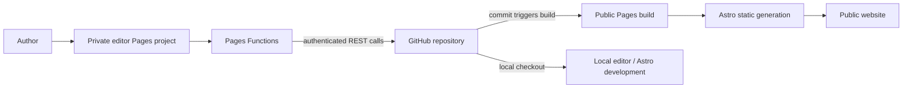

# Mind is a Universe

Mind is a Universe is a personal editorial website built with Astro. It publishes
long-form Markdown posts and short notes as a fast, mostly static site. A separate
private publishing desk lets an authenticated editor update those same Markdown
files without changing the public site's rendering code.

## Features

- Static Astro pages with content collections and strict frontmatter validation.
- Blog posts, short notes, tag archives, RSS, sitemap, syntax highlighting, and
  reading-time/progress UI.
- Paper-studio visual system implemented with CSS tokens and components.
- Private editor with rich-text, Markdown, split-preview, outline, draft, and
  publish controls.
- Git-backed publishing: production editor saves create GitHub commits; the
  public Cloudflare Pages project then rebuilds from the changed repository.

## Screenshots

Screenshots are not currently maintained in the documentation. Add current
public-site and editor screenshots here when they are available.

## Tech stack

- Node.js 22 or newer
- Astro 7, TypeScript configuration, and Markdown content collections
- Plain CSS and Astro components for the public UI
- Tiptap, CodeMirror, Lowlight, and esbuild for the editor
- Cloudflare Pages for hosting; Pages Functions for the production editor API
- GitHub REST Contents API for production content storage

## Architecture at a glance



The public project reads `src/content/posts/` and `src/content/notes/` at build
time. The editor project serves `editor/public/` and its Functions. The two
projects can use the same repository while having different roots, outputs, and
runtime responsibilities.

## Repository structure

```text
src/
  content/posts/       Long-form Markdown posts
  content/notes/       Short Markdown notes
  content.config.ts    Collection loaders and schemas
  pages/               Astro routes and RSS/robots endpoints
  components/          Reusable public-site components
  layouts/             Shared page layout
  styles/              Design tokens and global CSS
  utils/               Sorting, dates, slugs, and reading time
editor/
  public/              Static editor shell and bundled browser JavaScript
  src/editor.js        Editor source entry point
  functions/           Cloudflare Pages Functions and GitHub integration
  server.mjs           Local filesystem-backed editor server
```

## Local setup

Prerequisite: install Git and Node.js 22+. From PowerShell:

```powershell
git clone https://github.com/ParthAsopa/mind-is-a-universe.git
Set-Location .\mind-is-a-universe
npm install
npm run dev
```

Open the URL printed by Astro, normally `http://localhost:4321/` for Astro 7.
The editor uses a separate local Node server:

```powershell
$env:EDITOR_PASSWORD = "choose-a-long-local-password"
npm run editor
```

Open `http://localhost:4322/`. Run the public site separately to see local
Markdown changes. `EDITOR_PORT` can select another editor port.

## Commands

| Command | Purpose |
| --- | --- |
| `npm run dev` | Start the Astro development server. |
| `npm run build` | Generate the production site in `dist/`. |
| `npm run preview` | Preview the built `dist/` site locally. |
| `npm run editor` | Start the local filesystem-backed editor. |
| `npm run editor:build` | Bundle `editor/src/editor.js` to `editor/public/editor.js`. |

For editor operation, deployment, API details, and troubleshooting, see
[`editor/README.md`](./editor/README.md) and the detailed guides:

- [`docs/ARCHITECTURE.md`](./docs/ARCHITECTURE.md)
- [`docs/DEVELOPMENT.md`](./docs/DEVELOPMENT.md)
- [`docs/DEPLOYMENT.md`](./docs/DEPLOYMENT.md)
- [`docs/PUBLISHING-WORKFLOW.md`](./docs/PUBLISHING-WORKFLOW.md)
- [`docs/TROUBLESHOOTING.md`](./docs/TROUBLESHOOTING.md)

## Deployment overview

The public Cloudflare Pages project is expected to build from the repository root
with `npm run build` and publish `dist`. The editor is a second Pages project
using `editor/` as its root, publishing `public`, and discovering
`editor/functions/`. These intended settings are documented in
[`docs/DEPLOYMENT.md`](./docs/DEPLOYMENT.md); the Cloudflare dashboard itself is
not part of this repository, so production branch, domains, and project settings
must be verified there.

## Security notes

Never commit `EDITOR_PASSWORD`, GitHub tokens, cookies, or local secret files.
The production editor keeps its token in Pages environment variables and does
not send it to the browser. Use a fine-grained token limited to this repository
with Contents read/write and Metadata read-only. Add Cloudflare Access in front
of the editor hostname as an additional defense layer, and review password
rotation, rate limiting, and deployment logs periodically.
