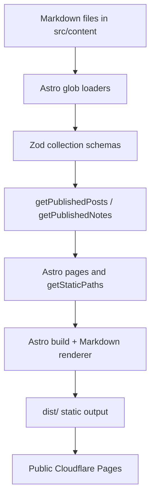
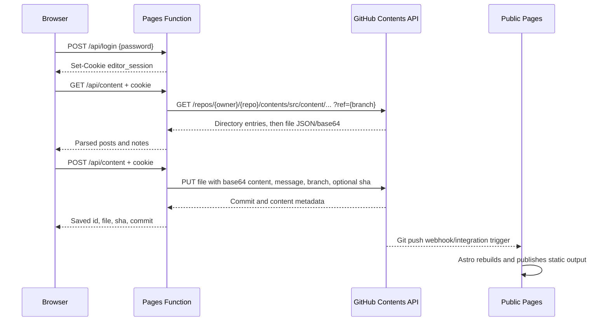

# Architecture

## System boundaries

There are two independently deployed Cloudflare Pages projects backed by one
Git repository:

1. **Public site**: the repository root is built by Astro into static HTML,
   CSS, JavaScript, feeds, and sitemap files.
2. **Private editor**: `editor/` serves a static browser application. Its Pages
   Functions authenticate requests and use GitHub as the production content
   store.

The editor does not call the public site to save content. Both systems converge
on the Markdown files in `src/content/posts/` and `src/content/notes/`.

## Public Astro site

Astro renders `.astro` pages and Markdown collection entries at build time.
`astro.config.mjs` sets the canonical site URL, trailing slash behavior,
directory output, Shiki's `github-dark` code theme, and sitemap generation.
`src/content.config.ts` defines two glob-backed collections:

- `posts`: `src/content/posts/**/*.md`, requiring `title`, coercible `date`,
  `description`, string-array `tags`, optional `outline`, and `draft`.
- `notes`: `src/content/notes/**/*.md`, requiring `title`, coercible `date`,
  `text` between 1 and 400 characters, and `draft`.

`src/utils/posts.ts` filters drafts only in production and sorts both collections
newest first. `src/pages/posts/[...slug].astro` calls `getStaticPaths`, renders
Markdown through `astro:content`, and adds the reading-progress script. Other
pages create the home feed, blog archive, notes archive, tag archives, RSS,
robots, and 404 response. `BaseLayout.astro` supplies metadata, canonical URLs,
RSS discovery, the sitemap link, header, and footer.

## Editor frontend

`editor/public/index.html` mounts `#app` and loads the bundled
`editor/public/editor.js`. The source is `editor/src/editor.js`; the
`editor:build` command bundles it with esbuild.

On startup the browser requests `GET /api/session`. It shows the login form
when unauthenticated; otherwise it creates a shell, requests
`GET /api/content`, and renders posts and notes in the library. Posts use
Tiptap with Markdown conversion, code blocks, tables, images, links, outlines,
and editor/Markdown/split views. CodeMirror backs the Markdown source view.
Notes use a simpler text form. The browser sends JSON to `POST /api/content`
when saving and displays API errors in the form status. It warns before leaving
with unsaved changes.

## Production Functions and API

| Route | Method | Auth | Behavior |
| --- | --- | --- | --- |
| `/api/login` | POST | No | Checks `{ password }`; sets a signed 24-hour session cookie. |
| `/api/session` | GET | No | Returns `{ authenticated: boolean }`. |
| `/api/logout` | POST | No | Clears the session cookie. |
| `/api/content` | GET | Yes | Lists and reads all Markdown posts and notes from GitHub. |
| `/api/content` | POST | Yes | Serializes and writes one post or note; may delete the old path after a rename. |

The production API is implemented by `editor/functions/api/` and shared modules
in `editor/functions/_lib/`. Failures while loading content are returned as
502; save failures are returned as 400; missing sessions are 401. GitHub error
diagnostics are logged with credentials redacted.

## Authentication and sessions

Production authentication is a password-only flow. The password is never
stored in the repository. `auth.js` compares SHA-256 digests in constant time,
creates a payload with an expiry and nonce, and signs the payload with an
HMAC-SHA-256 key derived from `EDITOR_PASSWORD`. The cookie is `HttpOnly`,
`SameSite=Strict`, `Path=/`, and lasts 24 hours; `Secure` is added for HTTPS.
Every protected content request validates the signature and expiry.

The local `server.mjs` intentionally uses a separate implementation: it keeps
random session tokens in an in-memory `Map` and checks the local environment
password with Node's timing-safe comparison. Restarting the process invalidates
local sessions.

## GitHub request lifecycle

GitHub calls use `https://api.github.com`, `Accept:
application/vnd.github+json`, `Authorization: Bearer ...`, API version
`2022-11-28`, and the `User-Agent: MindIsAUniverseEditor/1.0` header. Directory
and file reads are GET requests. Saves are PUT requests to the Contents API
with `message`, base64 `content`, `branch`, and an existing file `sha` when
editing. A changed slug additionally issues DELETE for the old path.

