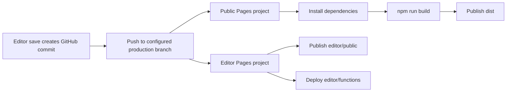

# Deployment

## What is confirmed by source

The Git remote is `ParthAsopa/mind-is-a-universe`, and the repository contains
the `master` branch. The root build command is `npm run build`, Astro outputs
`dist/`, and the editor's static output is `editor/public/`. The editor Functions
are under `editor/functions/`.

Cloudflare account, project, domain, production-branch, preview, retry, and
Access settings are dashboard state and cannot be verified from this checkout.
Confirm them manually before relying on a deployment.

## Public Pages project

Create or verify a Pages project connected to the repository:

| Setting | Intended value |
| --- | --- |
| Repository | `ParthAsopa/mind-is-a-universe` |
| Root directory | Repository root (`.`) |
| Build command | `npm run build` |
| Output directory | `dist` |
| Framework preset | Astro or None |
| Production branch | Verify in dashboard; source shows `master` exists |

On a push to the configured production branch, Cloudflare installs dependencies,
runs the build, and publishes `dist`. The exact branch trigger and deployment
retry policy require dashboard confirmation. For a failed deployment, inspect
the build log, correct the source or dashboard setting, and use the Pages
deployment action to retry/redeploy; the exact dashboard label and automatic
retry behavior must be confirmed in the account.

## Private editor Pages project

Create a second Pages project connected to the same repository:

| Setting | Intended value |
| --- | --- |
| Repository | `ParthAsopa/mind-is-a-universe` |
| Root directory | `editor/` |
| Build command | None (static files are already in `public/`) |
| Output directory | `public` |
| Functions directory | `functions/` under the project root |
| Production branch | Verify in dashboard; use the branch configured for GitHub operations |

Keeping these projects separate prevents the editor shell and API from becoming
part of the public site's static output while allowing editor commits to trigger
the public build. The editor does not need to deploy a Node server: Cloudflare
serves `public/` and runs each Function request at the edge.

## Editor environment variables

Configure these for the editor Pages project. Set both Production and Preview
values deliberately; do not assume a preview inherits production secrets.

| Variable | Purpose | Secret? |
| --- | --- | --- |
| `EDITOR_PASSWORD` | Password and HMAC signing key for editor sessions | Yes |
| `GITHUB_TOKEN` | GitHub Contents API authentication | Yes |
| `GITHUB_OWNER` | GitHub account or organization (`ParthAsopa`) | No |
| `GITHUB_REPO` | Repository name (`mind-is-a-universe`) | No |
| `GITHUB_BRANCH` | Branch used for content reads and writes (`master` is the current repository branch) | No |

The Functions fail explicitly when required GitHub variables are missing.
`EDITOR_PASSWORD` is also required for session signing. Store secrets as
encrypted Cloudflare secrets, not in source, and keep local Wrangler values in
ignored `.dev.vars` files if Wrangler is used.

## GitHub token permissions

Use a fine-grained token limited to this one repository:

- Repository access: only `ParthAsopa/mind-is-a-universe`
- Contents: **Read and write**
- Metadata: **Read-only**

The token is used only by Pages Functions. It is never returned to the browser.
Rotate it by updating the Pages secret and redeploying/retrying the editor
deployment if required by the dashboard.

## Cloudflare Access

The application password is the implemented application-level control. Add a
Cloudflare Access policy in front of the private editor hostname as an
additional layer, especially if the hostname is publicly discoverable. Access
configuration is not present in this repository and must be confirmed in the
Cloudflare dashboard.

## Publishing trigger

A successful Contents API PUT is a GitHub commit. GitHub integration then causes
the public Pages project to build from that commit. The editor's own deployment
is unrelated to each content save. If no public deployment starts, inspect the
public project's connected repository, production branch, build settings, and
Cloudflare deployment logs.
