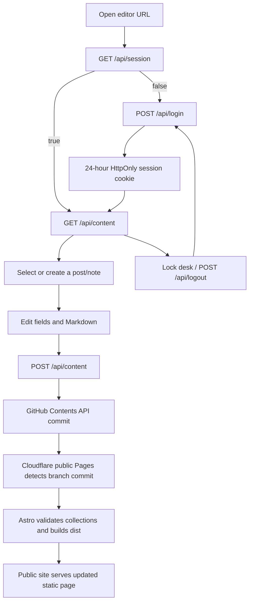

# Publishing workflow

## End-to-end lifecycle

1. **Open**: the browser loads static editor assets, then checks the session.
2. **Log in**: the password is posted to `/api/login`. On success, the
   Function sets `editor_session`; the token contains an expiry and HMAC
   signature. A failed password returns 401 and the UI shows the error.
3. **Load**: authenticated `GET /api/content` lists Markdown files in both
   content directories and reads each file. The Function parses frontmatter
   and returns editor-friendly JSON.
4. **Select**: the library sorts entries by date in the browser. Existing posts
   retain their GitHub file SHA for safe updates.
5. **Edit**: post fields include title, date, description, tags, outline, draft,
   and body. Notes include title, date, text, and draft. A new slug becomes a
   new filename.
6. **Save**: the browser serializes the item through the API. The Function
   writes base64-encoded Markdown with a commit message beginning `Save draft`
   or `Publish`. Editing an existing file supplies its SHA. Changing a slug
   writes the new path and deletes the old path.
7. **Build**: GitHub has now received a commit; this is not yet the public page.
   The separate public Pages integration must detect the commit, run Astro, and
   publish `dist`. Build queues, validation, and cache propagation can delay
   visibility.
8. **Lock**: the button calls `/api/logout`, which expires the cookie. The
   browser returns to the login view.

## Draft versus published

The editor's “Saved” status means GitHub accepted the save. A non-draft save is
labelled “Published to the site,” but the public site only displays it after
the public Pages build completes. A draft is stored in GitHub but
`getPublishedPosts`/`getPublishedNotes` exclude it when `import.meta.env.PROD`
is true. Local Astro development intentionally includes drafts.

## Why updates take time

There are at least three distinct events:

1. Markdown is saved through the editor.
2. GitHub creates the branch commit.
3. Cloudflare rebuilds and publishes the public static site.

The editor response confirms event 2, not event 3. Check GitHub for the commit,
then check the public Pages deployment for the corresponding build. Refreshing
the public page before event 3 completes will still show the previous static
output.

